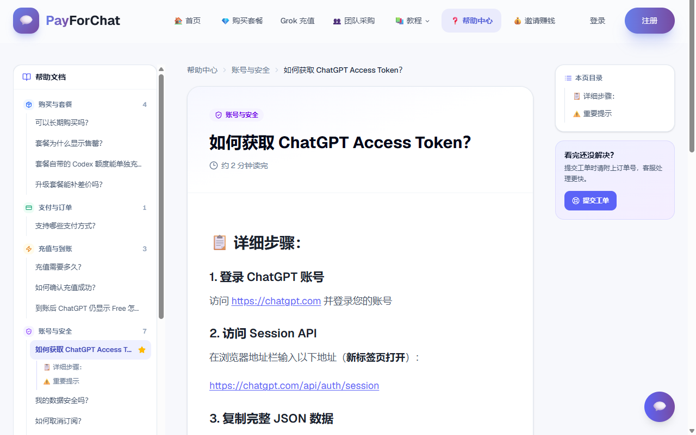

# ChatGPT Plus 国内怎么充值？没海外卡用微信 / 支付宝开通 Plus、Pro、Codex（2026 年 10 月核实）

> 信息最后核实：**2026-10-09**。本仓库由 [PayForChat](https://www.payforchat.com/?utm_source=github&utm_medium=readme&utm_campaign=plus-guide) 团队维护。PayForChat 是独立第三方充值服务，与 OpenAI 没有隶属、代理或授权关系。文中不写人民币价格，以套餐页实时标价为准。

没有海外信用卡、想把 ChatGPT Plus 或 Pro 开到**自己的账号**上：微信或支付宝付款，付完贴一次临时登录凭证（不是密码），Plus 一般 1–3 分钟到账，充值失败全额退款。

| 你想做什么 | 直接去 |
|---|---|
| 还没有 ChatGPT 账号 | [ChatGPT 怎么注册：邮箱怎么选、逐屏截图](https://www.payforchat.com/articles/chatgpt-register-guide-2026?utm_source=github&utm_medium=readme&utm_campaign=plus-guide) |
| 开通 Plus / Pro / Grok | [套餐页](https://www.payforchat.com/plans?utm_source=github&utm_medium=readme&utm_campaign=plus-guide) |
| 先看完整下单流程 | [ChatGPT Plus 购买完整指南](https://www.payforchat.com/articles/chatgpt-plus-buy-guide-2026?utm_source=github&utm_medium=readme&utm_campaign=plus-guide) |
| 用 Codex，或 Codex 额度不够 | [Codex 代充指南](https://www.payforchat.com/articles/codex-recharge-guide-2026?utm_source=github&utm_medium=readme&utm_campaign=plus-guide) |
| 已付款，查进度、提工单、下载 Invoice | [用户中心](https://www.payforchat.com/dashboard) |
| 公司采购、批量开通 | [团队采购](https://www.payforchat.com/team-purchase) |

## 零、还没有 ChatGPT 账号？先注册，约 5 分钟

- 只要一个能收信的邮箱，不需要手机号。有 Gmail 的在 chatgpt.com 点「使用 Google 账户继续」一步完成；没有的用 QQ 邮箱、163 邮箱也能注册，很多用户就这么用。Outlook / Hotmail 和买来的「成品邮箱」不要用。
- 注册和登录是同一个入口：chatgpt.com 右上角「免费注册」。记住自己用的是哪种方式（Google 还是邮箱），以后每台设备都用同一种。
- 邮箱怎么选、每一步截图、收不到验证码等报错怎么处理、注册完怎么开两步验证，见 [ChatGPT 怎么注册（2026 图文教程）](https://www.payforchat.com/articles/chatgpt-register-guide-2026?utm_source=github&utm_medium=readme&utm_campaign=plus-guide)。
- 充值的前提是账号当前没有在期订阅，刚注册的免费账号直接能办。

## 一、三步完成充值

1. **付款。** 打开[套餐页](https://www.payforchat.com/plans?utm_source=github&utm_medium=readme&utm_campaign=plus-guide)，选 Plus（1 个月、2 个月、3 个月或年卡），微信 / 支付宝 / 信用卡付款。
2. **贴凭证。** 在已登录 ChatGPT 的浏览器里打开 `https://chatgpt.com/api/auth/session`，把页面内容整段复制，粘贴到订单页。这是一段有时效的临时登录凭证，不是密码，充值成功后立即删除。图文步骤见[如何获取 ChatGPT Access Token](https://www.payforchat.com/help/chatgpt-access-token)。
3. **等到账。** 系统在你自己的账号上完成官方订阅，Plus 一般 1–3 分钟，邮件通知结果，订单页每一步都有状态。到账后登录 chatgpt.com 看套餐页确认。

全程在 payforchat.com 完成，不用加客服微信。2026-09-29 实测当天 3 笔 Plus 订单，付款到到账 2–4 分钟。

## 二、Plus、Pro 100、Pro 200、Pro 500 怎么选

| 套餐 | OpenAI 官方价 | 适合谁 | 现在能不能开 | 到账 |
|---|---|---|---|---|
| Plus | $20 / 月 | 日常对话、写作、学习，普通强度的 Codex | 能 | 1–3 分钟 |
| Pro 100（原 Pro 5X） | $100 / 月 | Plus 额度经常不够、个人高频 Codex、长文档和深度研究 | 能 | 以订单页提示为准 |
| Pro 200（原 Pro 20X） | $200 / 月 | 全天重度、多项目并行的 Codex 用户 | 能，2026-09-30 起恢复新购 | 正常短时间内完成，高峰期预计 1 小时内 |
| Pro 500 | $500 / 月 | 要 Astra Ultrafast，或 Pro 200 的用量还不够 | 能，2026-10-08 起 | 以订单页提示为准 |

- **档位改名了。** OpenAI 自 2026-09-29 起把两档 Pro 改称 Pro 100、Pro 200，并新增 Pro 500；Pro 200 同时恢复新购，新订阅的 Work / Codex 用量约为 Plus 的 10 倍。此前「暂停新购、到期 30 天内回归一次」的规则已失效。办理条件见 [Pro 200 说明](https://www.payforchat.com/pro-20x) 和 [Pro 500 说明](https://www.payforchat.com/pro-500)。
- **三档的前提一样：账号当前没有在期订阅。** 从没开过，或 Plus / Pro 已到期、变回普通账号的都能办；在期账号提交会在付款前被拦下，不扣款。Plus 不能补差价升 Pro，等到期后再开，或用一个干净的新账号开。
- **Codex 额度随套餐附带，不能单独买。** 三档用量差多少、值不值，见 [Pro 100 / 200 / 500 怎么选](https://www.payforchat.com/articles/chatgpt-pro-100-200-500-comparison-2026)；Codex 提示"已达到使用上限"怎么办，见[这篇](https://www.payforchat.com/articles/codex-usage-limit-reached-fix-2026)。
- **Grok** 的 SuperGrok / Super Heavy 也在同一个套餐页开通，见 [Grok 充值](https://www.payforchat.com/grok?utm_source=github&utm_medium=readme&utm_campaign=plus-guide)。

## 三、国内开 Plus 的四条路，为什么大多数人最后选代充

| 路径 | 前置条件 | 2026 年的实际情况 | 适合谁 |
|---|---|---|---|
| OpenAI 官网绑卡 | 海外实体卡 + 海外 IP + 对得上的账单地址 | 最稳，但国内发行的卡按卡号段直接被拒 | 有海外银行账户的人 |
| App Store 礼品卡内购 | 非国区 Apple ID + 对应区礼品卡 | 礼品卡有 5–10% 溢价，2026 年风控明显收紧；内购的订阅以后续费也只能走苹果 | 熟悉苹果生态、愿意折腾的 iPhone 用户 |
| 虚拟信用卡 | KYC + USDT 入金 | 头部平台 2025 年下半年起陆续停运，卡段被 Stripe 大面积标记，不建议新办 | 只剩存量卡的老用户 |
| **自助代充** | 无 | 微信 / 支付宝付款，订阅落在自己账号上，几分钟到账 | 没有海外卡、不想折腾的大多数人 |
| 共享账号 / 成品账号 | 无 | 对话互相可见、异地同时登录触发风控、随时可能被改密码或找回 | 不建议 |

**国内卡为什么总被拒：** OpenAI 的收银台走 Stripe，付款时做三道校验，任何一道不过就 decline。卡号前几位识别出中国大陆发卡行直接拒；支付时的 IP 要落在支持地区且不能是机房 IP；账单地址要和发卡行记录对得上。「Your card was declined」「付款未获批准」「Country not supported」是三个不同的问题，换卡解决不了 IP，换节点解决不了卡。细讲见 [ChatGPT 充值失败的原因与解决](https://www.payforchat.com/articles/chatgpt-topup-failed-reasons-solutions-2026)。

**选代充平台只看三条：** 订阅是不是完成在你自己的账号上（给你"现成账号"的是卖号，不是代充）；要不要密码（正规做法只要有时效的临时凭证，要密码、要验证码的直接绕开）；售后规则有没有写在页面上（失败退不退、掉订阅怎么算、订单能不能自己查）。PayForChat 这三条都写在页面上：[代充安全吗](https://www.payforchat.com/help/recharge-account-safety) · [售后保障](https://www.payforchat.com/help/after-sales-guarantee) · [服务条款](https://www.payforchat.com/terms)。五家平台的横评见 [2026 年代充平台对比](https://www.payforchat.com/articles/2026-chatgpt-plus-recharge-platforms-comparison)。

## 四、常见问题

**代充安全吗？会封号吗？**
充值直接完成在你自己的 ChatGPT 账号上，走正规渠道，账号始终是你的。"代充会封号"的说法几乎都来自共享账号（多人同时登录触发风控）和来路不明的成品账号，PayForChat 不做这两种。

**要交账号密码吗？我的凭证会被怎么处理？**
不要密码，也不要验证码。只用一段有时效的临时凭证完成这一次充值，成功后立即删除；敏感数据 AES-256 加密存储，传输全程 HTTPS。这段凭证是什么、安不安全，见 [chatgpt.com/api/auth/session 这串代码是什么](https://www.payforchat.com/articles/chatgpt-access-token-session-json-guide-2026)。

**到账后 ChatGPT 还显示 Free？**
多数是页面缓存。刷新或重开 App，退出再登录一次，确认登录的是订单里的邮箱，再等 5–10 分钟。超过 30 分钟仍是 Free，带订单号提[工单](https://www.payforchat.com/dashboard/tickets)，不要重复下单。

**可以给别人的账号充吗？下单后能换账号吗？**
可以给任何能登录 chatgpt.com 的账号充，填对应账号的凭证即可。一个订单只对应一个账号，下单后不能换绑，要换请重新下单。

**代充会自动续费吗？怎么关官方的自动续费？**
代充是一次性充值，到期自动停止，不会扣你的钱。如果你之前在官网绑过卡：chatgpt.com → 左下角头像 → My plan → Manage my subscription → Cancel plan，当前周期内照常使用。

**之前在 App Store 内购过的账号能代充吗？**
苹果内购的订阅还在有效期内时，续费、取消都在苹果那边操作，PayForChat 办不了；等它到期、账号变回普通状态后，和普通账号一样可以在 PayForChat 办理。拿不准先联系客服，别直接下单。

**充值失败、掉订阅怎么算？**
充值失败全额原路退款，联系客服或提工单即可。充值成功后因平台原因导致订阅中断，按已使用天数折算部分退款。因 OpenAI 政策原因被封禁的情形按[服务条款](https://www.payforchat.com/terms)处理。

**能开发票吗？**
已完成订单在用户中心自助下载 PDF Invoice（境外服务消费凭证，和 AWS、GitHub 的一样），按实付币种开具。已退款订单无法开票；不支持国内增值税发票。

**怎么联系客服？**
页面右下角在线客服、[工单](https://www.payforchat.com/dashboard/tickets)，或邮件 support@payforchat.com。其它问题见[帮助中心](https://www.payforchat.com/help)。

## 核实记录

| 日期 | 核对内容 |
|---|---|
| 2026-10-09 | 套餐页在售：Plus、Pro 100、Pro 200（9-30 起恢复新购）、Pro 500（10-08 上架）、Grok Super 与 Super Heavy；两档 Pro 已按 OpenAI 9-29 的新名称改写。新增「还没有账号先注册」一节，注册步骤按当日 chatgpt.com 页面核对。 |
| 2026-09-29 | 套餐页在售：Plus 1 / 2 / 3 个月与年卡、Pro 5X、Grok Super 与 Super Heavy；Pro 20X 仅续费或到期回归。实测当天 3 笔 Plus 订单，付款到到账 2–4 分钟。支付方式：微信、支付宝、Stripe 信用卡。 |
| 2026-09-20 | OpenAI 补充 Pro 20X「到期 30 天内一次性回归」规则，站内文章同步更新。 |
| 2026-09-10 | OpenAI 暂停 Pro 20X 新订阅，本指南 Pro 部分改为"仅续费或回归"。 |
| 2026-08-25 | 首版发布：四条充值路径对比、Stripe 风控机制说明。 |

发现内容过时、价格或政策变动、报错案例，欢迎提 Issue 或 PR，见 [CONTRIBUTING.md](CONTRIBUTING.md)。

## 延伸阅读

- [ChatGPT Plus 代充渠道怎么挑：五个问题问清楚](https://www.payforchat.com/articles/chatgpt-plus-daichong-channel-guide-2026)
- [GPT / ChatGPT 代充与充值全指南](https://www.payforchat.com/articles/2026-gpt-chatgpt-recharge-guide-plus-pro?utm_source=github&utm_medium=readme&utm_campaign=plus-guide)
- [ChatGPT Plus 续费指南](https://www.payforchat.com/articles/chatgpt-plus-renewal-guide-2026)
- [Plus 和 Pro 的区别](https://www.payforchat.com/articles/chatgpt-plus-vs-pro-comparison) · [Team 和 Plus 的区别](https://www.payforchat.com/articles/chatgpt-team-vs-plus-2026)
- [GPT 会员等级全解：Free / Go / Plus / Pro / Business](https://www.payforchat.com/articles/gpt-membership-tiers-guide-2026)
- [ChatGPT 怎么注册：邮箱怎么选、每一步截图、注册完先开两步验证](https://www.payforchat.com/articles/chatgpt-register-guide-2026?utm_source=github&utm_medium=readme&utm_campaign=plus-guide)
- 仓库 [docs/](docs/) 里另有 82 篇中文教程，从 AI 基础、ChatGPT 上手到 Codex 进阶，和充值无关。

## 关于本仓库

- 维护方：PayForChat 团队。PayForChat 是面向国内用户的 ChatGPT / Grok 订阅代充服务，已为 1 万+ 用户完成充值。
- 关联披露：本指南推荐自家服务；路径对比里其他方案的优缺点按实际情况写。发现错误请提 Issue。
- 觉得有用请点个 Star，让更多搜"ChatGPT Plus 怎么充值"的人能看到这一页。
- 协议：[CC BY 4.0](LICENSE)，署名即可转载与改编。
